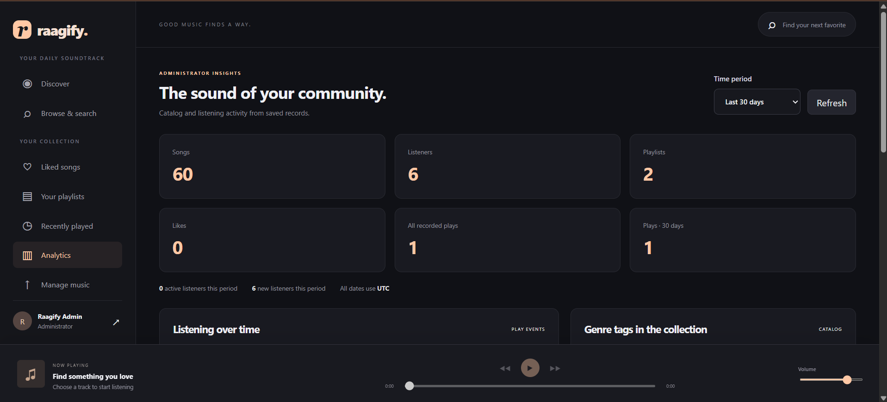
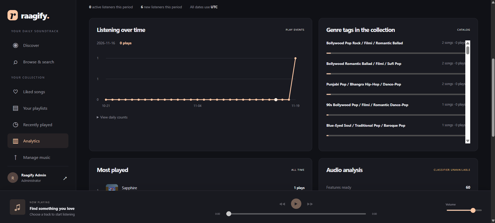
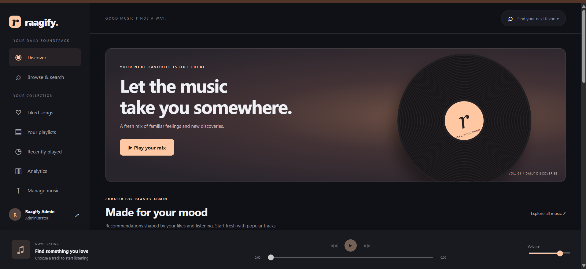
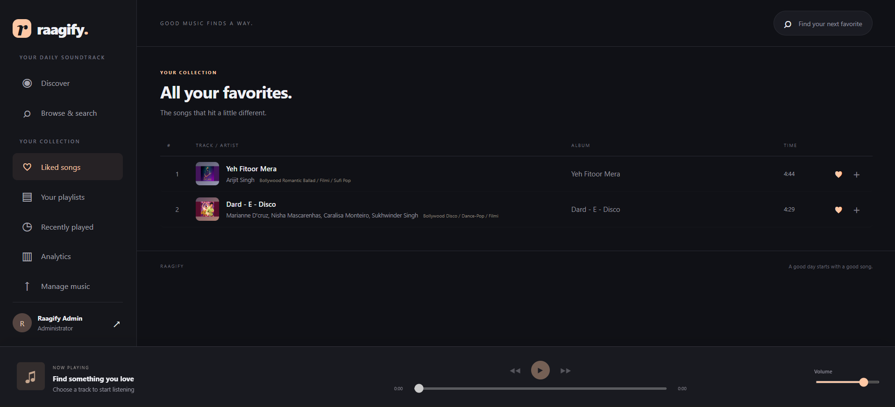
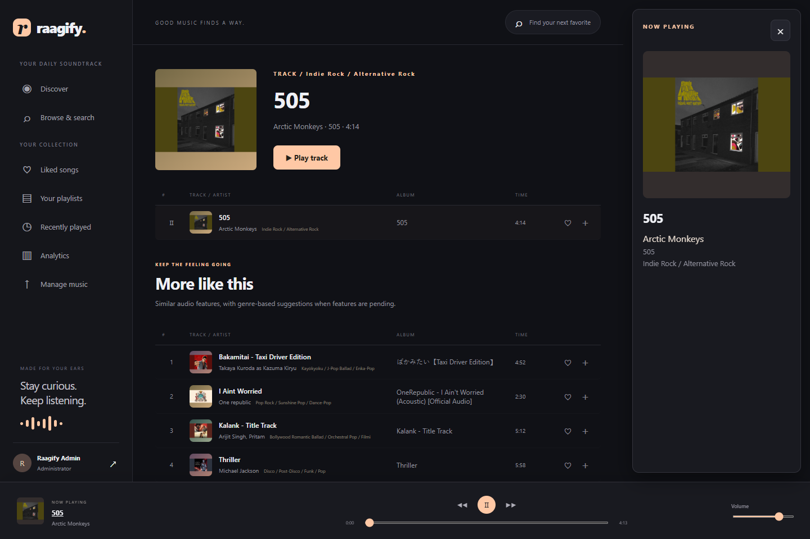
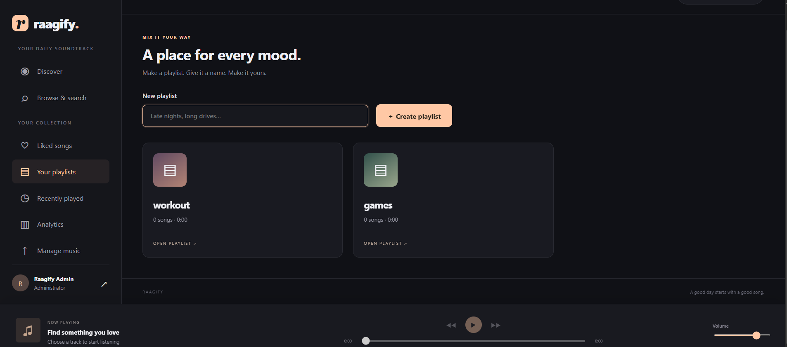
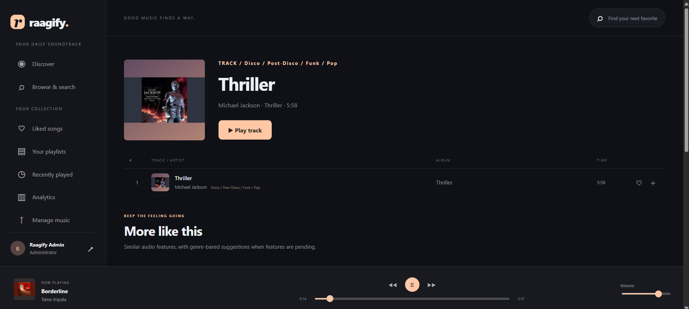

# Raagify

**Observed (source):** A music streaming app built with Java 21, Spring Boot 3.5.0, MySQL 8.4 with Flyway, React 19.1.0/Vite 6.3.5, and a Python FastAPI media processor. Listeners browse, search, stream, like songs, maintain private ordered playlists and receive recommendations. Administrators upload individual songs or batches and review listening analytics.

**Observed (source):** Trained genre classification has been removed. The Python service extracts real audio features, embedded tags and artwork. Genres come from administrator tags or embedded metadata; missing tags remain `Unclassified`. It does not guess song genres. The local 60-song library uses the supplied curated genre sets and embedded covers; private music, credentials and databases are excluded from Git.

## Screenshots

**Observed:** Screenshots supplied in `pics/` are displayed here. Their names identify the screen; add more images there and run `python tools/readme_screenshots.py` to refresh this gallery. Screenshots illustrate the UI; executable checks below provide separate runtime evidence.

**Observed:** The original analytics captures below predate the final media-processor update; their old classifier status label reflects that earlier UI.

<!-- screenshots:start -->

**Observed — Admin analytics1:**



**Observed — Admin analytics2:**



**Observed — Homepage:**



**Observed — Likedsongs:**



**Observed — Nowplayingpanel:**



**Observed — Playlist:**



**Observed — Songdetails:**



<!-- screenshots:end -->

## Run locally

**Recommendation:** Install Java 21, Maven 3.9.9+, MySQL 8.4, Node 24 and Python 3.12+. Create a dedicated database and account using private values:

```sql
CREATE DATABASE raagify CHARACTER SET utf8mb4;
CREATE USER 'raagify'@'localhost' IDENTIFIED BY 'your-private-password';
GRANT ALL ON raagify.* TO 'raagify'@'localhost';
```

**Recommendation:** Copy `.env.example` to `.env`, set database credentials and private `ADMIN_EMAIL` / `ADMIN_PASSWORD`, and load it in each service terminal. Keep the file untracked. Run these commands from the repository root.

```powershell
Copy-Item .env.example .env
# Edit .env, then load it in each terminal:
Get-Content .env | ForEach-Object {
    if ($_ -match '^([A-Z_]+)=(.*)$') {
        [Environment]::SetEnvironmentVariable($matches[1], $matches[2], 'Process')
    }
}
```

**Recommendation — media terminal:**

```powershell
python -m venv media-service/.venv
media-service/.venv/Scripts/python.exe -m pip install -r media-service/requirements.txt
media-service/.venv/Scripts/python.exe -m uvicorn app:app --app-dir media-service --host 127.0.0.1 --port 8000
```

**Recommendation — backend terminal:**

```powershell
mvn -f backend/pom.xml spring-boot:run
```

**Recommendation — frontend terminal:**

```powershell
npm.cmd --prefix frontend ci
npm.cmd --prefix frontend run dev -- --port 5173 --strictPort
```

**Observed (source):** Open http://localhost:5173. Vite proxies `/api` to Spring at `DEV_API_TARGET`, default http://127.0.0.1:8080. Set `MEDIA_SERVICE_URL` to the processor URL, default http://127.0.0.1:8000. Flyway applies and validates V1–V3; V3 removes retired classifier columns while preserving administrator genre overrides. Audio/cover paths are relative to the backend working directory unless absolute paths are configured.

**Recommendation — macOS/Linux:** Use `npm` and `media-service/.venv/bin/python`. Export environment values with shell-safe quoting or a dotenv runner. Do not source the unquoted example env file as shell code; its JDBC URL contains shell metacharacters.

## Administrator login and uploading music

**Recommendation:** Before the first backend start, set a private `ADMIN_EMAIL`, `ADMIN_PASSWORD` (12+ characters, maximum 72 UTF-8 bytes) and optional `ADMIN_NAME`. Sign in through the normal login form. Open **Manage music → Upload a song** or **Batch upload**. Public registration creates a listener account.

**Observed (source):** Bootstrap creates an administrator only when that email does not exist. It never promotes a listener or resets an existing password. For the local verification instance at http://127.0.0.1:15173, the admin email is `private-admin@raagify.test`; its password is stored in ignored `verification/runtime/secrets.json`. These values are not shipped. For an intentional password change in this isolated setup, `python verification/sync_local_admin.py` synchronizes that private account.

**Observed (source):** Upload WAV, MP3 or OGG, up to 25 MiB per file. Title, artist and duration are required; album, genre tags and cover are optional. Embedded details prefill the form. Embedded artwork is saved automatically unless a separate PNG/JPEG/WebP cover is provided (up to 5 MiB). Filename counters and download-site markers are cleaned; `53_505` becomes `505` while numeric titles such as `1979` remain intact.

**Observed (source):** Batch upload supports up to 25 songs, shared artist/album/genre fields, individual review, covers and sequential progress. Saved rows remain saved when another upload fails. Correct rejected tracks and retry the remaining rows. Unconfirmed network outcomes require checking the catalog before reselecting a file. Unsaved files stay in the current tab. Use **Edit** on saved tracks to update details, and **Restore embedded covers** for older uploads.

## Recommendations and analytics

**Observed (source):** The processor extracts 13 MFCC values, spectral centroid, tempo and 12 chroma values into a 27-value feature vector. Similar songs use cosine similarity, return at most 10, and exclude the source track. Personal recommendations combine liked/recent audio features with overlapping individual genre tags. New listeners receive popular songs; already-liked songs are excluded.

**Observed (source):** If media processing is down or times out, uploads still save with `PENDING` features. Genre/popularity fallback remains available. **Retry features** recovers the vector and embedded artwork while preserving curated administrator tags. Metadata and audio similarity require no downloaded or trained model.

**Observed (source):** The administrator-only analytics dashboard shows catalog/listener/playlist/like/play totals, 7/30/90-day listening activity, active/new listeners, popular songs, individual genre-tag counts, cover coverage and processor health. Dates use UTC. A song can have several tags, so genre counts can exceed the number of songs.

## Security and persistence

**Observed (source):** One session + CSRF authentication model protects browser/API writes. Identity comes from the session. Playlist ownership, likes and history are scoped to the current account. Duplicate likes and playlist entries return 409. Validated DTOs and global errors cover 400/401/403/404/409/413; hashes, file paths and raw feature vectors are not returned. Upload type, signature and size checks precede UUID file storage.

**Observed (source):** MySQL and audio/cover files persist across process restarts. Reloading the browser restores a live Spring session. Restarting Spring requires signing in again because sessions are in memory. The native audio player uses authenticated Range streaming and supports pause/play, next/previous, seek and volume. API and media requests share the browser origin.

**Observed (source):** Cover images throughout the app start the matching song when clicked, including catalog cards, likes, playlists, song details, admin lists and analytics. The bottom player displays the current cover. Clicking its song title opens a panel on the right with the large cover and metadata; it follows track changes and closes with × or Escape. Startup uses `/api/auth/session` to represent signed-out state without an expected 401 request; `/api/auth/me` and protected music endpoints still require authentication.

## Docker Compose

**Recommendation:** After editing `.env`:

```powershell
docker compose --env-file .env -f compose.yaml up --build -d
# Open http://localhost:5173
docker compose -f compose.yaml stop media
docker compose -f compose.yaml start media
# Stop while preserving uploaded music and database volumes:
docker compose -f compose.yaml down
```

**Observed (source):** Compose includes MySQL, Spring, React/Nginx and the media processor, with named database/media volumes. **Unverified:** Container runtime is not established because this host's Docker engine is unavailable. Configuration validation and the engine attempt are recorded separately.

## Verification

**Recommendation:** Run integration tests against a dedicated `raagify_test` schema with private test admin credentials and the real media processor available. Tests create fixtures; never point them at production.

```powershell
mvn -f backend/pom.xml test
npm.cmd --prefix frontend test
npm.cmd --prefix frontend run build
media-service/.venv/Scripts/python.exe -m pytest -q media-service
```

**Observed:** Exact commands, pass counts and real browser/API outcomes for the final media-only version are in [verification/MEDIA_PROCESSOR.md](verification/MEDIA_PROCESSOR.md). Historical initial-build results remain in [verification/REPORT.md](verification/REPORT.md) and [verification/BATCH_UPLOAD.md](verification/BATCH_UPLOAD.md); references to the former classifier there describe earlier executions. A mocked client test or frontend build is not evidence of a working full-stack app.

**Recommendation — this verification host:** `verification/runtime.py` manages isolated MySQL on 33317, Spring on 18080, the processor on 18000 and Vite on 15173. It uses ignored local credentials/data, portable MySQL (or `VERIFY_MYSQL_HOME`), the host Java/Node paths, and Python httpx/PyMySQL/psutil/Playwright dependencies. `tools/maven.py` supports the portable Maven installation.

```powershell
python verification/runtime.py setup
python verification/runtime.py package
python verification/runtime.py start
python verification/runtime.py backend-tests
python verification/runtime.py frontend-tests
python verification/runtime.py python-tests
python verification/media_dashboard_smoke.py
python verification/batch_upload_smoke.py
# Stopping invalidates live sessions:
python verification/runtime.py stop
```

**Unverified:** Physical speaker output, every audio codec, production deployment and recommendation quality against a user study have not been established. There is no trained genre classifier to evaluate.

## Repository

**Observed:** Delivery repository: [sid17905/Raagify](https://github.com/sid17905/Raagify). Historical REA files and the reference changelog remain local and ignored. Publishing from this runner uses the isolated `.cache/publish` checkout; private runtime data and credentials are excluded. `Raagify.bundle`, when present locally, exports the Git history.

**Recommendation:** See [docs/ARCHITECTURE.md](docs/ARCHITECTURE.md) for API contracts and service responsibilities.
