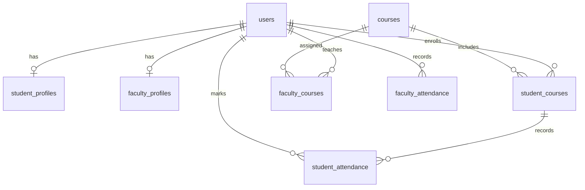

# College source evidence and Java 21 revision

**Observed:** The detailed evidence below is retained from the original source snapshot; its paths and defects describe the untouched original. Executed checks apply to the clearly named revised copy or starter and are summarized in the ledger. Original response projections are Inference where derived from getters/configuration rather than exercised HTTP. Labels apply to the immediately following claim, list item, table row/cell or code block.

## College project: backend source analysis

**Inference:** This section describes `ReactJavaDemoApplication-main/college-management-system`. All behavior below is **observed in source**, unless explicitly marked **inference**, **recommendation**, or **unknown**. HTTP success shapes are derived from controller return types and entity getters, not a running server. No backend compilation or runtime test was performed. Source references in this section use the prefix `ReactJavaDemoApplication-main/college-management-system/`; Java references additionally use `src/main/java/com/example/college/`.

### Technology and libraries

| Classification | Item | Declared version / evidence | Purpose |
| --- | --- | --- | --- |
| Observed | Java | `25`, `pom.xml:30` | Records for request DTOs; switch expressions; pattern matching for `UserDetails`; collections and time API |
| Observed | Spring Boot | `4.1.2`, `pom.xml:8` | Dependency management, configuration, application startup, embedded web server |
| Observed | Maven project | `com.example:college-management-system:0.0.1-SNAPSHOT` | Build/package application |
| Observed | Maven wrapper | Wrapper `3.3.4`; distribution Maven `3.10.0`, `.mvn/wrapper/maven-wrapper.properties:1` | Project-local Maven launcher |
| Observed | `spring-boot-starter-webmvc` | Boot-managed | REST controllers, request/response binding, JSON serialization |
| Observed | `spring-boot-starter-data-jpa` | Boot-managed | Spring Data repositories and Hibernate ORM; transactional writes |
| Observed | `spring-boot-starter-security` | Boot-managed | Authentication manager, password hashing, session security context, method authorization, CSRF/CORS integration |
| Observed | `spring-boot-starter-security-oauth2-client` | Boot-managed | Google authorization-code login |
| Observed | `spring-boot-starter-validation` | Boot-managed | Jakarta Bean Validation request constraints |
| Observed | `mysql-connector-j` | Boot-managed, runtime scope | JDBC connection to MySQL |
| Observed | `spring-boot-devtools` | Boot-managed, runtime/optional | Development support |
| Observed | JPA/security/OAuth2/validation/webmvc test starters | Boot-managed, test scope | Test support; only an empty `contextLoads` test is supplied |
| Observed | Jackson | Framework dependency; source imports `JsonIgnore` | Serialize returned maps/entities; hide password field |
| Observed | BCrypt | `BCryptPasswordEncoder`, `config/SecurityConfig.java:36` | One-way salted password hashing |

**Observed:** There is no Lombok, JWT library, Redis, message broker, scheduler, email provider, file storage provider, Flyway/Liquibase migration, or OpenAPI generator declared in this backend POM. This is a bound statement about the inspected POM/source, not about a deployed system. Exact original-POM transitive versions have now been resolved by dependency:tree; see the observed appendix below.

### Architecture and modules


**Inference — original example/source projection:**

```text
HTTP request
  -> Spring Security filter chain: CORS, CSRF, authentication/session
  -> role-protected controller when applicable
  -> AccountService or CollegeService
  -> JpaRepository interface / derived query
  -> Hibernate -> MySQL
  -> Jackson JSON response
```

**Observed:** Dependency injection is constructor-based. Controllers define routes and bind inputs; services implement business rules; entities map persistent records; repositories derive queries from method names. `AdminController.users()` directly calls a repository rather than the service. `AccountService` creates users and role-specific profiles atomically with `@Transactional`. `CollegeService` creates/assigns/enrolls/marks attendance transactionally. Read methods are not explicitly transactional in this source.

| Classification | Module | Entry points | Behavior |
| --- | --- | --- | --- |
| Observed | Identity and local registration | `AuthController`, `AccountService`, `DatabaseUserDetailsService` | Register student, authenticate email/password, store session security context, read current user |
| Observed | Google identity | `GoogleLoginSuccessHandler` | Find Google subject; create pending student; reject automatic linking by redirect; redirect to frontend |
| Observed | Administration | `AdminController` | Create students/faculty/courses, list users, assign faculty to course |
| Observed | Course catalog | `CourseController` | List active courses for any authenticated user |
| Observed | Student enrollment | `StudentController` | Enroll current student in academic session, list own enrollments and attendance |
| Observed | Faculty teaching/attendance | `FacultyController` | List assigned courses, inspect enrolled students only for assigned course, mark student/self attendance |
| Observed | Profile and dashboard | `ProfileController` | Identity summary and role-dependent counts |
| Observed | Bootstrap and health | `DataInitializer`, `HealthController` | Seed one admin when missing; report application UP |

### Persistent schema and relationship rules

**Observed:** Every entity has an auto-increment `Long id` (`GenerationType.IDENTITY`). Tables are explicitly named. Described Java types and declared constraints are source facts; exact generated SQL column casing and index names depend on the resolved Hibernate naming strategy and database.

| Classification | Table/entity | Fields and defaults | Relationships / constraints |
| --- | --- | --- | --- |
| Observed | `users` / `User` | `fullName` String required length 100; `email` required unique length 150; `password` nullable length 255; `role` required enum string length 20; `status` required enum string defaults ACTIVE; `authProvider` required enum string defaults LOCAL; `googleSubject` nullable unique length 150; `createdAt` required non-updatable LocalDateTime; `updatedAt` LocalDateTime | Identity root. `@PrePersist` sets createdAt/updatedAt; `@PreUpdate` updates timestamp. Password `@JsonIgnore`. `entity/User.java:10` |
| Observed | `student_profiles` / `StudentProfile` | `rollNumber` required unique length 30; department; semester; admissionDate set to `LocalDate.now()` in constructor; phone; address length 500 | One-to-one lazy, required `user_id`, unique FK to users. `entity/StudentProfile.java:9` |
| Observed | `faculty_profiles` / `FacultyProfile` | `employeeId` required unique length 30; department; designation; qualification; phone; address length 500 | One-to-one lazy, required unique `user_id` FK to users. `entity/FacultyProfile.java:5` |
| Observed | `courses` / `Course` | `courseCode` required unique length 30; `courseName` required length 120; department; credits Integer; active boolean defaults true | Independent catalog. `entity/Course.java:5` |
| Observed | `faculty_courses` / `FacultyCourse` | assignedOn LocalDate defaults today | Required many-to-one `faculty_id` -> users and `course_id` -> courses; composite unique `(faculty_id, course_id)`. `entity/FacultyCourse.java:6` |
| Observed | `student_courses` / `StudentCourse` | academicSession required length 30; enrolledOn today; status required string length 20 defaults `ENROLLED` | Required many-to-one `student_id` -> users and `course_id` -> courses; composite unique `(student_id, course_id, academic_session)`. `entity/StudentCourse.java:6` |
| Observed | `student_attendance` / `StudentAttendance` | attendanceDate required LocalDate; status required enum string length 20 | Required many-to-one `student_course_id` -> student_courses; required `marked_by` -> users; composite unique `(student_course_id, attendance_date)`. `entity/StudentAttendance.java:7` |
| Observed | `faculty_attendance` / `FacultyAttendance` | attendanceDate required LocalDate; status required enum string length 20 | Required many-to-one `faculty_id` -> users; composite unique `(faculty_id, attendance_date)`. `entity/FacultyAttendance.java:7` |


**Observed — original example/source projection:**



**Observed:** Persisted enums: roles `ADMIN`, `STUDENT`, `FACULTY`; account statuses `ACTIVE`, `INACTIVE`, `PENDING`, `BLOCKED`; providers `LOCAL`, `GOOGLE`; attendance statuses `PRESENT`, `ABSENT`, `LEAVE`. Enrollment status is a String rather than an enum. Faculty-course assignment has no academic-session dimension; student-course enrollment does.

**Observed:** No cascade or orphan-removal policy is declared on these relationships. Most many-to-one relations use default fetch settings. No inverse collections are present on `User`/`Course`, which bounds JSON graph expansion. Profiles have no controller that returns their complete fields; the profile route returns only identity fields despite the larger persistent model.

### Request DTO contracts

**Observed:** JSON property names follow record component names:

| Classification | Request | Fields | Validation |
| --- | --- | --- | --- |
| Observed | `RegisterRequest` | fullName, email, password, rollNumber, department, semester | All nonblank; name max 100; email valid/max 150; password size 8..72; controller applies `@Valid` |
| Observed | `CreatePersonRequest` | fullName, email, password, identifier, department, detail | Name/email/password/identifier/department nonblank; email valid; password size 8..72; detail optional; controller applies `@Valid` |
| Observed | `CreateCourseRequest` | courseCode, courseName, department, credits | Code/name nonblank; credits nonnull and positive; department optional; controller applies `@Valid` |
| Observed | `MarkAttendanceRequest` | studentCourseId Long, attendanceDate LocalDate, status enum | Components declare `@NotNull`, but faculty endpoint does **not** apply `@Valid` |
| Observed | Login map | email, password | Only manual null/blank check; no DTO or size constraints |

**Observed:** For admin person creation, `identifier` becomes student roll number or faculty employee ID; `detail` becomes semester or designation respectively. These semantics are in `AccountService.createPerson`, not the DTO name. Date values are intended as ISO `YYYY-MM-DD` in frontend/API contracts; actual binder behavior was not exercised. Java `@Size` measures characters, not BCrypt's byte limit, so a reconstruction should also handle Unicode passwords correctly.

### Exact API inventory

**Observed:** Success statuses are default 200 unless stated. State-changing requests require CSRF even for public registration/login. `Public` means authentication is permitted to be absent; it does not disable CSRF.

| Classification | Method and path | Access | Input | Success body | Source |
| --- | --- | --- | --- | --- | --- |
| Observed | GET `/api/health` | Public | None | **Inference:** `{application:"College Management System",status:"UP"}` | `controller/HealthController.java:7` |
| Observed | GET `/api/auth/csrf` | Public | None | **Inference:** `{token: String}` plus CSRF cookie through configured repository | `controller/AuthController.java:48` |
| Observed | POST `/api/auth/register` | Public + CSRF | RegisterRequest JSON | **Inference:** **201** `{message:"Student account created. Please log in.",email}` | `controller/AuthController.java:54` |
| Observed | POST `/api/auth/login` | Public + CSRF | `{email,password}` JSON | **Inference:** `{id,fullName,email,role,status}` and session cookie | `controller/AuthController.java:69` |
| Observed | GET `/api/auth/me` | Authenticated filter chain | None | **Inference:** `{id,fullName,email,role,status}` | `controller/AuthController.java:111` |
| Observed | POST `/api/auth/logout` | Spring Security logout filter + CSRF | No body required | **Inference:** **204**, no body | `config/SecurityConfig.java:85` |
| Observed | GET `/api/courses` | Authenticated | None | **Inference:** `Course[]`, active records only | `controller/CourseController.java:11` |
| Observed | GET `/api/profile` | Authenticated | None | **Inference:** `{id,fullName,email,role,status,authProvider}` | `controller/ProfileController.java:10` |
| Observed | GET `/api/dashboard` | Authenticated | None | **Inference:** `{user: profile, ...roleCounts}` | `controller/ProfileController.java:11` |
| Observed | POST `/api/admin/students` | ADMIN | CreatePersonRequest JSON | **Inference:** User entity | `controller/AdminController.java:17` |
| Observed | POST `/api/admin/faculty` | ADMIN | CreatePersonRequest JSON | **Inference:** User entity | `controller/AdminController.java:18` |
| Observed | GET `/api/admin/users` | ADMIN | None | **Inference:** User[] (including nonactive accounts) | `controller/AdminController.java:19` |
| Observed | POST `/api/admin/courses` | ADMIN | CreateCourseRequest JSON | **Inference:** Course entity | `controller/AdminController.java:20` |
| Observed | POST `/api/admin/faculty/{facultyId}/courses/{courseId}` | ADMIN | IDs are **User ID** and Course ID; no JSON body | **Inference:** FacultyCourse entity | `controller/AdminController.java:21` |
| Observed | POST `/api/student/courses/{courseId}/enroll` | STUDENT | Optional query `session`, defaults `2026-2027`; no JSON body | **Inference:** StudentCourse entity | `controller/StudentController.java:14` |
| Observed | GET `/api/student/courses` | STUDENT | None | **Inference:** StudentCourse[] owned by current user, all sessions | `controller/StudentController.java:16` |
| Observed | GET `/api/student/attendance` | STUDENT | None | **Inference:** StudentAttendance[] owned through enrollment | `controller/StudentController.java:17` |
| Observed | GET `/api/faculty/courses` | FACULTY | None | **Inference:** FacultyCourse[] assigned to current user | `controller/FacultyController.java:16` |
| Observed | GET `/api/faculty/courses/{courseId}/students` | FACULTY, assigned to course | Course ID | **Inference:** StudentCourse[] for course, all sessions | `controller/FacultyController.java:17` |
| Observed | POST `/api/faculty/attendance/students` | FACULTY, assigned to enrollment's course | MarkAttendanceRequest JSON | **Inference:** StudentAttendance entity | `controller/FacultyController.java:18` |
| Observed | POST `/api/faculty/attendance/self` | FACULTY | Required query `status` and `date`; no JSON body | **Inference:** FacultyAttendance entity | `controller/FacultyController.java:19` |
| Observed | GET `/api/faculty/attendance/self` | FACULTY | None | **Inference:** FacultyAttendance[] owned by current user | `controller/FacultyController.java:20` |

**Inference:** Framework OAuth paths, inferred from default Spring Security configuration: browser navigation to `/oauth2/authorization/google`; provider callback `/login/oauth2/code/google`. These are framework-handled, not source controller mappings.

**Observed:** Controller responses currently expose entity getter shapes:


**Inference — original example/source projection:**

```text
User = {id, fullName, email, role, status, authProvider, googleSubject, createdAt}
Course = {id, courseCode, courseName, department, credits, active}
FacultyCourse = {id, faculty: User, course: Course}
StudentCourse = {id, student: User, course: Course, academicSession, status}
StudentAttendance = {id, attendanceDate, status, studentCourse: StudentCourse}
FacultyAttendance = {id, attendanceDate, status}
```

**Observed:** `password` is hidden with `@JsonIgnore`; `updatedAt`, assignedOn, enrolledOn, student-attendance markedBy and faculty-attendance faculty have no corresponding getters, so they are not part of the ordinary bean response contract. This is derived from source getters and should be confirmed against resolved Jackson settings before treating the JSON as a frozen public contract. There are no explicit response DTOs for these entities.

**Observed:** Dashboard count fields: ADMIN receives `totalUsers` and `totalCourses` (all records, including inactive courses); STUDENT receives `enrolledCourses`; FACULTY receives `assignedCourses`. The dashboard always includes `user` containing the identity profile. Enrollment/assignment counts load lists and call `.size()` rather than execute SQL count queries.

### Business logic and fundamentals

1. **Observed:** **Register local student** (`service/AccountService.java:22`): check email case-insensitively; check roll number; trim/lowercase saved email; BCrypt-hash password; save ACTIVE LOCAL STUDENT; save StudentProfile with roll number/department/semester. Both saves occur in one transaction. Email duplicate check happens before trimming; normalized duplicate checking should be performed on the normalized value in a reconstruction.
2. **Observed:** **Admin creates person** (`service/AccountService.java:31`): check email; normalize/hash; save ACTIVE LOCAL user with controller-selected role; save matching profile. Duplicate identifier protection relies on database uniqueness here; faculty `existsByEmployeeId` repository method exists but is not used. Admin cannot select ADMIN role through these creation routes.
3. **Observed:** **Create course** (`service/CollegeService.java:33`): check code case-insensitively; save active course. Code is not normalized before saving.
4. **Observed:** **Assign faculty** (`service/CollegeService.java:43`): load user and verify FACULTY; load course; reject duplicate pair; save FacultyCourse. Does not check ACTIVE user/course status.
5. **Observed:** **Enroll student** (`service/CollegeService.java:50`): derive current user from session principal; verify STUDENT; load course; reject duplicate student/course/session tuple; save ENROLLED StudentCourse. Does not require active course or validate academic-session format/length at the HTTP layer.
6. **Observed:** **List course roster** (`service/CollegeService.java:59`): verify current faculty is assigned to course, then return all StudentCourse records for that course. No session filter/pagination.
7. **Observed:** **Mark student attendance** (`service/CollegeService.java:64`): derive marker; verify FACULTY; reject Saturday/Sunday; load StudentCourse; require assignment to its course; fetch all attendance for that student and stream-check duplicate enrollment/date; save attendance with marker. DB composite uniqueness also protects concurrent duplicates. Future/backdated weekdays are allowed by current code.
8. **Observed:** **Mark faculty attendance** (`service/CollegeService.java:78`): derive faculty, verify role, reject weekend, fetch all own attendance and stream-check date duplicate, save. Current faculty chooses PRESENT/ABSENT/LEAVE for self without approval.
9. **Observed:** **Own data** (`service/CollegeService.java:57`, `:86`): repository queries always use current user's ID for own courses/attendance. This illustrates server-derived ownership rather than trusting a browser userId.
10. **Observed:** **Profile/dashboard** (`service/CollegeService.java:26`, `:88`): return identity and minimal role-specific summary. Full profile fields and update operations are not implemented.

**Observed:** Fundamentals used include relational normalization, composite unique constraints as final concurrency guards, repository query derivation, transactional creation of dependent records, service-level invariants, role-based access control, authenticated-owner scoping, and date/enum business rules. Replace full-list duplicate scans with indexed `existsByStudentCourseIdAndAttendanceDate` / `existsByFacultyIdAndAttendanceDate` queries while preserving unique constraints; catch constraint races and return a conflict response.

### Local login, CSRF, CORS and session integration

**Observed:** `DatabaseUserDetailsService` looks up email case-insensitively, rejects any account not ACTIVE, builds Spring UserDetails with the stored password and `ROLE_<database role>` authority (`security/DatabaseUserDetailsService.java:13`). BCrypt matches local login passwords. This role mapping supports enabled `@PreAuthorize` annotations on admin/student/faculty controllers.

**Observed:** `AuthController.login` accepts JSON, verifies nonblank email/password, calls `AuthenticationManager.authenticate`, creates a new SecurityContext, sets the authenticated token, and writes it to the HTTP session under `SPRING_SECURITY_CONTEXT` (`controller/AuthController.java:84`, `:96`). The response is the five-field user summary. This backend **uses sessions, not JWT**. Frontend requests must include credentials to carry the server session cookie.

**Observed:** `SecurityConfig` permits public health/CSRF/register/login, OPTIONS requests, root and `/error`; all other requests require authentication. Form login and HTTP Basic are disabled. `CookieCsrfTokenRepository.withHttpOnlyFalse()` is enabled; frontend JavaScript can read the CSRF cookie, while the session credential should remain HttpOnly under the server's normal cookie policy. The allowed request header is `X-XSRF-TOKEN`. Public login/register still require CSRF because permission rules do not bypass the CSRF filter. Use `/api/auth/csrf` to obtain a token and establish the CSRF cookie, then send the JSON endpoint's token with credentials for every unsafe method. Do not interchange a framework-masked JSON token with a raw cookie token without matching the configured CSRF request handler; exact Spring Security version behavior should be tested.

**Observed:** CORS allows exactly `http://localhost:5173`, methods GET/POST/PUT/PATCH/DELETE/OPTIONS, headers Content-Type/X-XSRF-TOKEN/X-Requested-With, and credentials. An alternate host (`127.0.0.1`) or Vite port (`5174`) will not match this configuration. Browser CORS does not replace backend authorization. SameSite/Secure cookie properties, session timeouts, session persistence, explicit API authentication entry point, rate limits and lockout policies are not configured in inspected application properties.

**Observed — prior-pass verification limit:** The `/me` controller contains 401/404 JSON branches, but the security filter may intercept an unauthenticated request before those branches execute. **Unknown:** exact unauthenticated redirect/status/content-type behavior without running the resolved framework. A reconstruction should explicitly configure API 401/403 JSON handlers and test them. Current copied-source results are recorded in REA_EVIDENCE_LEDGER.md; this statement concerns the original analysis pass.

### Google OAuth implementation and gaps

**Observed:** Observed handler sequence (`security/GoogleLoginSuccessHandler.java:30`): read Google `sub`, `email`, `name`; redirect invalid-profile when subject/email absent; fall back to email as name; find user by Google subject; if absent, check email collision and redirect `google=link-required` rather than automatically link; otherwise create a GOOGLE STUDENT with PENDING status and null local password; reject nonactive user by redirect `google=pending`; redirect active user to `http://localhost:5173/`.

**Observed:** The intended account-linking policy is conservative, but implementation is incomplete:

| Classification | Source fact | Consequence / required reconstruction change |
| --- | --- | --- |
| Observed | Handler returns after redirects without clearing authentication/security context or invalidating session (`GoogleLoginSuccessHandler.java:49`, `:75`, `:97`) | **Recommendation:** **Inference:** redirecting does not itself revoke an already successful OAuth login. A pending user or local-email collision may retain provider authentication. Reject before establishing app authentication, or clear/invalidate on denial. `/me` resolves OAuth email without rechecking status. |
| Observed | No custom OAuth/OIDC user service or authorities mapper is wired (`SecurityConfig.java:81`) | **Recommendation:** **Inference:** provider authorities do not become database `ROLE_STUDENT`/`ROLE_FACULTY`/`ROLE_ADMIN`; method-role-protected routes will fail for Google login. Map approved database user role into app authorities. |
| Observed | `CurrentUser.require` uses `auth.getName()` for any principal that is not UserDetails (`security/CurrentUser.java:15`) | **Recommendation:** **Inference:** Google authentication names commonly use subject ID rather than email, causing most CollegeService operations to fail database lookup, although `/me` separately extracts email correctly. Centralize identity resolution using verified provider subject/app user ID. |
| Observed | New Google user has no StudentProfile; only User is saved | **Recommendation:** Add a profile-completion workflow if enrollment requires institution identity; define whether pending student can use any resources. |
| Observed | No account activation, blocking or provider-linking controller exists in the inspected controller set | **Recommendation:** PENDING Google account cannot become ACTIVE using the supplied application API. Implement ADMIN status transition and explicit verified account-linking flow if Google is required. |
| Observed | Handler does not check `email_verified`; configured scope is `profile,email` without explicit `openid` | **Recommendation:** Verify intended Google protocol/userinfo behavior and verified-email policy against the provider. Do not assume OIDC claims are available just from variable names. |
| Observed | Redirects hardcode localhost:5173 | **Recommendation:** Make frontend callback origin configurable; validate redirect destinations. |

**Observed:** These are source-based integration/security findings, not results of a penetration test. Google OAuth credentials are required placeholders with no defaults; provider registration/callback behavior and real credentials were not exercised.

### Configuration, launch prerequisites and verification evidence

**Observed:** Source configuration (`src/main/resources/application.properties:7`): server port 8080; MySQL at localhost:3306 database `college_management_db`, JDBC SSL disabled for the local example, timezone Asia/Kolkata; `DB_USERNAME`/`DB_PASSWORD` environment overrides with development defaults; Hibernate `ddl-auto=update`; SQL logging and formatted SQL enabled; JSON indentation enabled. Bootstrap admin email/password are hardcoded in source; values intentionally omitted here. Google client ID/secret come from `GOOGLE_CLIENT_ID`/`GOOGLE_CLIENT_SECRET` with no fallback.

**Observed:** `DataInitializer` creates an ACTIVE LOCAL ADMIN only when configured email does not already exist; it hashes configured password and uses hardcoded fullName `College Administrator` (`config/DataInitializer.java:17`). `app.bootstrap-admin.name` is defined but unused. Existing admin password/role/status are not reset on restart. No students, faculty, courses or enrollments are seeded.

**Observed:** Required setup for a reconstruction using these declared dependencies:

1. **Recommendation:** Use an appropriate JDK matching the chosen Java target. **Observed environment:** `java -version` returned JDK 21.0.10; project declares Java 25, so the checked environment does not satisfy this compiler target. Do not report the current backend as successfully compiled.
2. **Observed:** Restore/use the Maven wrapper and resolve the declared artifacts. Wrapper properties point at Maven 3.10.0; artifact availability/resolution was not checked. If selecting a different supported Java/Boot/Maven combination for a new project, document it as a deliberate change and verify compatibility rather than silently assuming these versions are available.
3. **Observed:** Create isolated MySQL database `college_management_db` and a least-privilege user. Provision schema access for development `ddl-auto=update`; for a production reconstruction use versioned migrations and `ddl-auto=validate`.
4. **Observed:** Configure DB credentials and bootstrap credentials securely. Use Spring property overrides such as `APP_BOOTSTRAP_ADMIN_EMAIL` and `APP_BOOTSTRAP_ADMIN_PASSWORD`; do not copy source defaults. Set Google environment credentials and registered callback if using OAuth; alternatively make Google registration conditional for a local-only reconstruction.
5. **Observed:** From backend directory, run `./mvnw.cmd test` and `./mvnw.cmd spring-boot:run` on Windows, after resolving the JDK and dependency prerequisites. These are **suggested run commands**, not executed-success claims.
6. **Observed:** Run corresponding frontend on localhost:5173, configure its API target to this backend, and exercise CSRF fetch -> registration/login -> `/me` -> role workflow -> logout with actual browser cookies.

**Observed — prior-pass verification limit:** The only supplied test is `src/test/java/com/example/college/CollegeManagementSystemApplicationTests.java:7`, an empty `@SpringBootTest contextLoads` test. It does not verify API contracts, roles, CSRF, transactions, duplicate handling, ownership or OAuth behavior. No tests were run by this analysis agent because JDK target mismatch was established by read-only inspection. Database and Google credentials/runtime availability remain unknown. Current copied-source results are recorded in REA_EVIDENCE_LEDGER.md; this statement concerns the original analysis pass.

### Defects and implementation limits an agent should address

| Classification | Issue evidenced in source | Suggested implementation |
| --- | --- | --- |
| Observed | Missing `@Valid` on student-attendance request (`controller/FacultyController.java:18`) | **Recommendation:** Apply validation; add nonnull/positive ID/date/status constraints and safe 400 response. Current null date can throw before a useful error. |
| Observed | No `@RestControllerAdvice` in inspected sources; services throw IllegalArgumentException/IllegalStateException | **Recommendation:** Define consistent 400/401/403/404/409 responses. Do not assume a business-rule exception currently becomes a friendly 400. |
| Observed | Custom login manually stores context without invoking session authentication strategy (`AuthController.java:84`) | **Recommendation:** Use a proper authentication filter or invoke the framework's session strategy and SecurityContextRepository; verify session ID rotation and CSRF token lifecycle. Avoid assuming standard form-login protections apply to this controller. |
| Observed | Source contains database/admin credential defaults; local JDBC SSL disabled | **Recommendation:** Externalize secrets, use least-privilege DB credentials, disable bootstrap after initialization, use TLS and production logging policy. |
| Observed | Admission/assignment does not require active course/account; dates not bounded | **Recommendation:** Define allowed states/date window and enforce in service, not only UI. |
| Observed | Course rosters and attendance lists span all sessions and have no pagination | **Recommendation:** Add session filtering, pagination, indexed duplicate checks and count queries. |
| Observed | Direct entity responses expose googleSubject and potentially unnecessary user metadata | **Recommendation:** Use explicit minimal DTOs, including only data required for each role/task. |
| Observed | No update/delete endpoints, grade/exam/timetable/fees module, password reset, email verification, audit log or export | **Recommendation:** Treat these as future scope; do not claim they exist because this is a college-management name. |

### Rebuilding the backend for any analogous idea

**Observed:** Preserve the patterns, then adapt nouns and role names: `User` -> actor; `Course` -> catalog/resource; `StudentCourse` -> enrollment/booking/subscription; `FacultyCourse` -> resource stewardship/assignment; attendance -> dated activity/event. Keep role-specific profile tables only when the idea has distinct profile data. For a booking app, use reservation records with resource/time uniqueness rather than copying academic-session constraints; for a project app, use work-item assignments and status transitions. Domain-specific invariants must follow the new idea.

**Recommendation:** Start with a role/ownership matrix, entity fields/constraints, endpoint DTOs and one full frontend-to-database workflow. Implement authentication and central current-user resolution before business endpoints. Choose a single auth model (this backend's session + CSRF or another project's bearer token model) and pair frontend HTTP configuration accordingly. Write migrations, repositories, services and controllers for the agreed contracts. Return DTOs instead of persistence graphs. Add negative-case tests for unauthorized roles, another user's records, duplicate concurrent writes, null inputs, invalid dates, and account status restrictions. Only add Google after local registration/login/current-user/logout works and provider roles, status enforcement and profile completion are tested.

**Observed — prior-pass verification limit:** For this college domain, a complete minimum acceptance flow is: bootstrap/admin login -> create faculty and course -> assign faculty -> student registration/login -> enroll in course/session -> faculty login -> load assigned roster -> mark weekday student attendance -> student sees own attendance -> faculty marks own weekday attendance -> dashboards show role counts -> logout invalidates access. Each action must persist in MySQL and survive process restart. The supplied source expresses this local-login flow; executing it successfully remains unverified. Current copied-source results are recorded in REA_EVIDENCE_LEDGER.md; this statement concerns the original analysis pass.

## College application: frontend and integration

### Scope and evidence

**Observed:** The business application frontend is `ReactJavaDemoApplication-main/college-management-ui`. `ReactJavaDemoApplication-main/testUiproject` is a separate Vite starter, not an additional business module. This analysis inspected every first-party frontend source file, manifests, lockfiles, Vite configuration, the supplied environment example, and corresponding backend controller/service/security code. Source observations establish the implemented structure and requests; they do not establish successful browser login or database operation. A production frontend build was executed successfully on 2026-11-18 with existing dependencies; no dependencies were installed and no application source was changed.

### Technology and libraries

**Observed:** Both frontends use JavaScript ES modules and JSX, React function components, hooks, ReactDOM's `createRoot`, Vite, and the React Vite plugin. The college application uses Context for account state and local component state for page data. It does not use Redux, TypeScript, Next.js, SSR, a form library, a query/cache library, or a charting library in the inspected sources.

**Observed:** The version ranges below are declared in `college-management-ui/package.json:12`; the exact versions are the supplied `package-lock.json` resolutions, not an assertion of current upstream releases.

| Classification | Library | Manifest range | Lockfile version | Purpose in this project |
| --- | --- | --- | --- | --- |
| Observed | React | `^19.0.0` | `19.3.1` | Component rendering, hooks, Context |
| Observed | ReactDOM | `^19.0.0` | `19.3.1` | Mount SPA into the HTML root |
| Observed | React Router DOM | `^7.1.5` | `7.18.5` | Browser history routing, links, role redirects |
| Observed | Axios | `^1.8.4` | `1.21.1` | JSON HTTP client, credentialed requests, CSRF interceptor |
| Observed | Bootstrap | `^5.3.3` | `5.3.9` | Grid, navigation, tables, cards, forms, alerts, buttons |
| Observed | `@vitejs/plugin-react` | `^4.3.4` | `4.7.0` | JSX/React development and build integration |
| Observed | Vite | `^6.1.0` | `6.4.6` | Development server, HMR, production asset build |

**Observed:** `main.jsx:3` imports Bootstrap CSS and its bundled JavaScript, then `index.css`. No Bootstrap JavaScript widget is evident in the business pages; most usage is through CSS classes. `vite.config.js:3` registers only the React plugin; it defines no proxy, custom server port, or backend integration. The resolved router requires Node `>=20.0.0`; resolved Vite allows Node 18/20/22+, so use Node 20+ or a compatible newer LTS satisfying both. The verification host had Node `24.14.0`.

### Entry point, component ownership, and frontend fundamentals


**Inference — original example/source projection:**

```text
index.html root
  -> main.jsx: React.StrictMode
     -> AuthProvider: account state and auth operations
        -> App: BrowserRouter / Routes
           -> public Login / Register
           -> ProtectedPage
              -> ProtectedRoute: waits for account, checks allowed roles
                 -> AppLayout: top navbar, role sidebar, main content
                    -> role dashboard / feature page
```

**Observed:** Evidence: `college-management-ui/src/main.jsx:9`, `src/App.jsx:21`, `src/components/ProtectedRoute.jsx:4`, `src/components/AppLayout.jsx:4`.

**Observed:** The implementation demonstrates these reusable fundamentals:

- **Observed:** **Declarative UI:** JSX derives the view from state. Arrays become course cards, users become table rows, and status/message strings conditionally render alerts.
- **Observed:** **State ownership:** `AuthProvider` owns the shared account; each page owns its lists, errors, messages, and form values. `useAuth()` reads the Context rather than passing the account through every component.
- **Observed:** **Controlled forms:** input values come from state, `onChange` updates state, and `onSubmit` prevents browser form navigation before sending an asynchronous request. `Register` uses computed object keys; `AdminCourses` converts credits to a number before JSON serialization.
- **Observed:** **Effects and promises:** page-mount `useEffect` fetches data. Promise success stores `response.data`; rejection stores an error message. MyCourses and Attendance reload when the `user` object changes. StrictMode may run development effects twice; these effects fetch data and do not perform business writes.
- **Observed:** **Route composition:** the reusable `ProtectedPage` wraps each feature with both authorization UX and the common layout. BrowserRouter manages client-side URLs. Deployment must serve `index.html` for direct SPA paths such as `/student/my-courses`.
- **Observed:** **Backend-owned identity:** the account is reconstructed by `/auth/me` after a refresh; it is not persisted in localStorage. Feature requests do not submit the current user's ID for self-service actions; the backend determines that identity from the session.

### Exact frontend route map

**Observed:** All route declarations: `college-management-ui/src/App.jsx:25`.

| Classification | URL | Allowed role(s) | Component | Implemented behavior |
| --- | --- | --- | --- | --- |
| Observed | `/` | Public entry | HomeRedirect | Wait for account load; unauthenticated -> `/login`; otherwise ADMIN -> `/admin`, FACULTY -> `/faculty`, other account -> `/student` |
| Observed | `/login` | Public | Login | Email/password login; Google navigation; register link |
| Observed | `/register` | Public | Register | Public student registration |
| Observed | `/admin` | ADMIN | Dashboard | Shared dashboard UI plus backend summary |
| Observed | `/admin/users` | ADMIN | Users | Read-only list of name/email/role/status |
| Observed | `/admin/courses` | ADMIN | AdminCourses | Active course list and course creation form |
| Observed | `/student` | STUDENT | Dashboard | Role, account status, summary |
| Observed | `/student/courses` | STUDENT | Courses | Active course catalog and Enrol action |
| Observed | `/student/my-courses` | STUDENT | MyCourses | Current student's enrollment cards |
| Observed | `/student/attendance` | STUDENT | Attendance | Current student's attendance table |
| Observed | `/faculty` | FACULTY | Dashboard | Role, account status, summary |
| Observed | `/faculty/courses` | FACULTY | MyCourses | Assigned course cards |
| Observed | `/faculty/attendance` | FACULTY | Attendance | Faculty's own attendance table |
| Observed | `/profile` | ADMIN, STUDENT, FACULTY | Profile | Read-only account snapshot from AuthContext |
| Observed | Any other URL | Any | Navigate | Redirect to `/` |

**Observed:** `ProtectedRoute` shows a loading account message until the initial request finishes, redirects no account to login, and redirects wrong role to `/`. Frontend checks are UX controls. Backend controller `@PreAuthorize` checks and service ownership checks enforce authorization even when a caller skips the browser UI.

**Observed:** `AppLayout` uses a Bootstrap dark blue navbar; ADMIN sidebar contains Dashboard/Users/Courses, FACULTY contains Dashboard/My Courses/Attendance, and STUDENT contains Dashboard/a link labelled My Courses/Attendance. All roles also get My Profile and Logout. **Observed navigation defect:** the STUDENT link labelled My Courses targets `/student/courses` (catalog), while the actual enrolled-course route `/student/my-courses` has no sidebar link (`src/components/AppLayout.jsx:14`). A reconstruction should expose distinct Catalog and My Courses links.

### API configuration and session/CSRF contract

**Observed:** Evidence: `college-management-ui/src/services/api.js:3`, `src/context/AuthContext.jsx:10`; backend `college-management-system/src/main/java/com/example/college/config/SecurityConfig.java:54`, `controller/AuthController.java:48`.


**Recommendation — original example/source projection:**

```dotenv
# Frontend .env.local; these values are public URLs, never secrets.
VITE_API_BASE_URL=http://localhost:8080/api
VITE_BACKEND_URL=http://localhost:8080
```

**Observed:** The same names and defaults are supplied by `college-management-ui/.env.example`. `VITE_API_BASE_URL` includes `/api`; `VITE_BACKEND_URL` does not, because the Google authorization endpoint is outside the business API. Vite reads these at development startup/build time; rebuild after changing production values. `VITE_*` values are compiled into client assets and must never contain database passwords, OAuth secrets, or private signing keys.

**Observed:** The Axios singleton enables `withCredentials: true` and JSON Content-Type. The browser carries the backend session cookie. The backend CORS configuration currently accepts only the exact frontend origin `http://localhost:5173`, enables credentials, and permits `X-XSRF-TOKEN`. Frontend/backend must agree on origins and cookie attributes; `localhost` and `127.0.0.1` are different hosts, and `5174` is not the permitted origin.

**Observed:** The client holds a CSRF token in a module variable, initially null. `refreshCsrf()` GETs `/auth/csrf` and stores `{token}`. A request interceptor checks the HTTP method; POST/PUT/PATCH/DELETE fetch a token if missing and attach it as `X-XSRF-TOKEN`. GET requests do not trigger the interceptor refresh, so the CSRF-fetch GET cannot recurse. The frontend sends the token returned by the endpoint; do not substitute an arbitrary cookie value without agreeing with the backend token handler.

**Observed:** Initial account load executes `refreshCsrf() -> GET /auth/me -> setUser`, and always ends the loading state. Any failure results in `user=null`, including connectivity failures. Password login executes `refreshCsrf() -> POST /auth/login -> setUser -> refreshCsrf() -> return account`; the Login page navigates based on `role`. Registration refreshes CSRF and POSTs the form; it displays the returned message and redirects to login after 1200 ms, without automatically signing in. Logout refreshes CSRF, POSTs logout, clears the account, refreshes CSRF again, then the layout navigates to login.

**Observed:** The account shape expected and returned by login/me is:


**Inference — original example/source projection:**

```json
{"id":1,"fullName":"Example Person","email":"person@example.test","role":"STUDENT","status":"ACTIVE"}
```

**Observed:** There is no JWT/Bearer-token logic in this frontend. There is also no response interceptor for expired sessions, no general retry, and no request timeout configured. For a new application, distinguish a 401 session expiry from a transport failure and refresh CSRF on an identified token-invalid response before a controlled retry. Do not blindly retry non-idempotent writes.

### Complete frontend-to-backend request inventory

**Observed:** The request paths below are relative to the Axios base URL, whose default is `http://localhost:8080/api`. All writes carry the session cookie and CSRF header. Roles in this table describe feature authorization; register/login/CSRF are public but still subject to the backend CSRF policy for writes.

| Classification | Frontend operation/source | Request | Body/query | Response fields consumed |
| --- | --- | --- | --- | --- |
| Observed | `services/api.js:11` refresh | GET `/auth/csrf` | None | `{token}` |
| Observed | `context/AuthContext.jsx:13` restore | GET `/auth/me` | None | Account object above |
| Observed | `context/AuthContext.jsx:24` login | POST `/auth/login` | `{email,password}` | Account object |
| Observed | `context/AuthContext.jsx:32` register | POST `/auth/register` | `{fullName,email,password,rollNumber,department,semester}` | `{message,email}`; success is HTTP 201 |
| Observed | `context/AuthContext.jsx:37` logout | POST `/auth/logout` | No body | HTTP 204; no JSON consumed |
| Observed | `pages/Login.jsx:44` Google | Full-page GET `${VITE_BACKEND_URL}/oauth2/authorization/google` | Spring OAuth redirect flow | Redirect back to frontend; `/auth/me` restores session account |
| Observed | `pages/Dashboard.jsx:12` | GET `/dashboard` | None | JSON object rendered in `<pre>`; role/status from Context |
| Observed | `pages/Users.jsx:5` | GET `/admin/users` | None | Array `{id,fullName,email,role,status,...}` |
| Observed | `pages/AdminCourses.jsx:5`, `pages/Courses.jsx:6` | GET `/courses` | None | Array `{id,courseCode,courseName,department,credits,...}` |
| Observed | `pages/AdminCourses.jsx:7` | POST `/admin/courses` | `{courseCode,courseName,department,credits:Number(...)}` | Returned entity ignored; then reload list |
| Observed | `pages/Courses.jsx:8` | POST `/student/courses/{id}/enroll` | No body/query; backend default `session=2026-2027` | Returned enrollment ignored; success message |
| Observed | `pages/MyCourses.jsx:6` student | GET `/student/courses` | None | Array of enrollment objects; card reads `{id,course:{courseName,courseCode,department}}` |
| Observed | `pages/MyCourses.jsx:6` faculty | GET `/faculty/courses` | None | Array of faculty-assignment objects; same nested `course` fields |
| Observed | `pages/Attendance.jsx:6` student | GET `/student/attendance` | None | Array `{id,attendanceDate,status,...}` |
| Observed | `pages/Attendance.jsx:6` faculty | GET `/faculty/attendance/self` | None | Array `{id,attendanceDate,status,...}` |

**Observed:** Dashboard's backend response is `{user,...counts}`: ADMIN gets `totalUsers`/`totalCourses`, STUDENT gets `enrolledCourses`, FACULTY gets `assignedCourses` (`service/CollegeService.java:88`). The current UI presents the object as formatted JSON rather than rendering those counts as business cards; the three visible cards show role, status, and whether dashboard data loaded.

**Observed:** Course collection responses contain Course entities. MyCourses responses contain relationship entities with a nested Course; preserving this distinction is required for the existing JSX. Enrollment is identified by the relationship row ID, not just by the course ID. A new application may use DTOs, but update client and server together if flattening these shapes.

### Forms, styling, and user interactions

**Observed:** Login (`src/pages/Login.jsx:13`) has controlled email/password values, native HTML required/email validation, a busy flag disabling submission, and an inline error alert. Google is a regular anchor that leaves the SPA. Query `google=pending` displays an activation message, and `google=link-required` displays an account-linking message. The backend also redirects `google=invalid-profile`, but the Login JSX has no corresponding message. OAuth redirect destinations on the backend are hard-coded to `http://localhost:5173`; changing only the frontend environment variables does not update those destinations.

**Observed:** Register (`src/pages/Register.jsx:7`) requires all six fields, uses native `minLength=8` for password, and keeps semester as text. Backend validation also caps full name at 100, email at 150, and password at 72; the UI does not mirror those max lengths. Backend creates local STUDENT accounts ACTIVE. Registration success text uses `response.data.message` correctly. There is no busy flag, so duplicate submissions are possible until the backend rejects duplicates.

**Observed:** AdminCourses (`src/pages/AdminCourses.jsx:4`) initializes credits to 3; course code/name are required, department optional, credits numeric minimum 1. Success resets the form and reloads active courses. The reload after a successful write is not awaited/caught in `submit`, so a subsequent fetch failure can become an unhandled rejection. There is no edit/deactivate/delete action or submit busy flag.

**Observed:** Courses renders a three-column-at-medium-width card grid and an Enrol button for STUDENT. Success displays a message but does not track already-enrolled IDs, disable the button, or reload enrollments. A second click relies on the backend duplicate rule. Backend uniqueness is student+course+academic session, and the UI offers no academic-session selector.

**Observed:** Attendance presents only Date and Status and the explanatory text that Saturday/Sunday are non-working days. Student attendance can contain multiple course-enrollment records on the same date, but the UI does not display course identity. MyCourses shows the nested course name/code/department and omits academic session/status. Profile displays only Context fields and never calls the existing `/api/profile` endpoint, which would add `authProvider`.

**Observed:** `src/index.css:1` establishes light gray page backgrounds, system/Inter font fallbacks (no font download is configured), dark navy sidebar, rounded white cards, and subtle shadows. Bootstrap classes implement responsive `col-md-*` layout, `table-responsive`, spacing, form controls, and alerts. There is no separate design system, CSS module pipeline, Tailwind configuration, or animation subsystem in the inspected business frontend.

### Observed integration gaps and reconstruction decisions

| Classification | Source observation | Consequence | Recommendation for a complete new application |
| --- | --- | --- | --- |
| Observed | Student sidebar routes My Courses to catalog | **Inference:** Enrolled-course screen lacks discoverable navigation | **Recommendation:** Separate Catalog and My Courses links |
| Observed | Users only fetches/renders a table | **Inference:** No UI for backend student/faculty creation or course assignment | **Recommendation:** Add role-specific create forms and assignment selectors connected to existing API contracts |
| Observed | Attendance only performs GETs | **Inference:** Faculty cannot mark their own or student attendance through the supplied UI | **Recommendation:** Add assigned-course roster, weekday date picker, student status form, and faculty self-mark form |
| Observed | Google PENDING message asks administrator to activate | **Inference:** No frontend activation action exists; inspected admin controller also has no activation route | **Recommendation:** Add explicitly authorized account activation API/UI, and enforce status during session use |
| Observed | API callers commonly read `response.data.error`; AuthController explicitly returns `{message}` for several errors | **Inference:** Precise errors may be replaced with generic fallback; default Spring error fields may show generic status text | **Recommendation:** Use a consistent backend error DTO and a shared frontend extraction helper (`message`, then `error`, then fallback) |
| Observed | Login handles two Google result flags but not `invalid-profile` | **Inference:** Invalid Google attributes yield an unexplained login page | **Recommendation:** Render every documented result or use one structured reason mapping |
| Observed | Auth restore catch maps every failure to no user | **Inference:** Backend outage appears as signed-out state | **Recommendation:** Track account-load error independently from unauthenticated state |
| Observed | Auth account is set before post-login CSRF refresh completes | **Inference:** A CSRF refresh failure can display login failure despite an authenticated backend session | **Recommendation:** Deliberately handle authenticated account and token-refresh failure as separate states |
| Observed | No centralized 401/403 handling, timeout, cancellation, or loading/empty state on most lists | **Inference:** Stale or unclear UI on expiry/outage; Dashboard stays labelled Loading after failure | **Recommendation:** Add bounded timeout, effect cleanup, explicit pending/error/empty UI and safe session recovery |
| Observed | AdminCourses post-success `load()` promise is not awaited | **Inference:** Reload failure is not handled by the surrounding try/catch | **Recommendation:** Await reload or attach its own catch |
| Observed | No test script or test setup in college frontend manifest | **Inference:** Build success alone cannot verify business workflows | **Recommendation:** Add meaningful integration/e2e checks for session restore, role denial, enrollment, and attendance writes |

**Observed:** Backend code and UI must agree on OAuth principals and authorities. The frontend role redirects use the database role returned by `/auth/me`; the backend must also map OAuth authorities to that same role for `@PreAuthorize` to pass. Redirecting a user to a role page alone does not confer authorization. Backend account linking/activation/status defects are covered in the backend analysis; they should be fixed there rather than bypassed in route guards.

### Rebuild recipe for a different management idea

**Recommendation:** Use the college structure as a small session-authenticated management SPA. First define new roles, core resources, ownership rules, relationship rows, status transitions, and API request/response DTOs. Replace Student/Faculty/Course names with the new domain, while preserving the distinction between a resource and the relationship assigning/enrolling a person to that resource.

**Recommendation:** Then implement the backend persistence/security contract, the shared Axios credentials/CSRF client, AuthProvider, role guard, layout, and a complete feature slice. A useful sequence is admin creates a resource -> eligible user sees it -> user enrolls/is assigned -> relationship appears in My Resources -> authorized actor performs a status/attendance-like write -> the affected user sees the persisted result. Each screen must call a real endpoint and reload or update real persisted data after a write. Avoid delivering read-only tables for modules whose requirements include actions.

**Recommendation:** Keep identity in the session on the server, enforce roles and object ownership server-side, and return narrowly scoped response DTOs. UI guards should help navigation while server guards decide access. Pair every asynchronous operation with loading/error/success handling, disable duplicate writes while pending, and align frontend validation with backend validation. Extend this skeleton with pagination/search, accessible labels, standardized errors, DTOs, and transaction/uniqueness enforcement as needed by the idea.

**Observed:** For development, start the backend at `http://localhost:8080`, supply the frontend URL variables, and run from `college-management-ui`:


**Recommendation — original example/source projection:**

```powershell
# In a fresh environment, install the lockfile dependencies first.
npm.cmd ci
npm.cmd run dev -- --host localhost --port 5173 --strictPort

# Production assets:
npm.cmd run build
```

**Recommendation:** Use `--strictPort` because the backend CORS/OAuth settings currently require 5173. A reverse-proxy deployment can expose SPA and `/api` on one HTTPS origin; then update the API base URL, OAuth callback/redirect URLs, CORS allowlist, and session-cookie settings consistently. Backend installation/configuration requirements are described separately. Do not claim a frontend production build proves a working backend.

### Verification results

**Observed — prior-pass verification limit:** Observed: `npm.cmd run build` in `college-management-ui` exited 0, using Vite `6.4.6`, transforming 116 modules and producing `dist/index.html`, a 231.86 kB CSS asset and a 421.50 kB JS asset (gzip 31.02 kB and 134.26 kB). Existing `node_modules` was used. These artifacts were generated inside the project workspace. This validates bundling and static import resolution. Browser interactions, cookies, CSRF, Google login, database persistence, authorization, and business behavior remain unverified by this build. Current copied-source results are recorded in REA_EVIDENCE_LEDGER.md; this statement concerns the original analysis pass.

### Separate `testUiproject` starter

**Observed:** `ReactJavaDemoApplication-main/testUiproject/src/App.jsx:8` contains one local counter initialized to zero; a functional state update increments it on click (`:27`). The rest renders React/Vite illustrations and documentation/community links. It has no API client, backend calls, auth state, router, business entities, or persistence. It does not demonstrate a second backend integration. Its README explicitly describes a React+Vite template and says React Compiler is not enabled.

| Classification | Library | Manifest range | Lockfile version |
| --- | --- | --- | --- |
| Observed | React, ReactDOM | `^19.3.1` | `19.3.1` |
| Observed | Vite | `^8.3.6` | `8.3.8` |
| Observed | `@vitejs/plugin-react` | `^6.1.2` | `6.3.0` |
| Observed | ESLint | `^10.14.0` | `10.15.0` |
| Observed | `@eslint/js` | `^10.0.1` | `10.0.1` |
| Observed | `eslint-plugin-react-hooks` | `^7.1.1` | `7.1.1` |
| Observed | `eslint-plugin-react-refresh` | `^0.5.7` | `0.5.8` |
| Observed | `globals` | `^17.13.0` | `17.14.0` |
| Observed | `@types/react`, `@types/react-dom` | `^19.3.0` | `19.3.0` |

**Observed:** Source: `testUiproject/package.json:13`, `package-lock.json`, `eslint.config.js:7`, `vite.config.js:5`. The type packages supply editor/declaration support; the files remain JavaScript, not a TypeScript application. ESLint's flat configuration ignores dist, checks JS/JSX, and applies recommended JavaScript/hooks/React-refresh rules with browser globals. Scripts are dev/build/lint/preview. Resolved Vite/plugin require Node `^20.19.0 || >=22.12.0`; ESLint requires `^20.19.0 || ^22.13.0 || >=24`, so satisfy the intersection. No `node_modules` existed for this starter at inspection; no build/lint was run and no install was attempted.

## Applied copy and current verification

# College copy changes and verification notes

**Observed:** Changes are confined to `revised-projects/college/backend/`. The original `ReactJavaDemoApplication-main/college-management-system/` is unchanged. Original guide findings continue to describe that original snapshot.

## Version migration (request point 2)

| Classification | File | Original target | Copied target |
| --- | --- | --- | --- |
| Observed | `pom.xml` | Spring Boot 4.1.2, Java 25 | Spring Boot 3.5.0, Java 21 |
| Observed | `pom.xml` | `spring-boot-starter-webmvc` | `spring-boot-starter-web` |
| Observed | `pom.xml` | `spring-boot-starter-security-oauth2-client` | `spring-boot-starter-oauth2-client` |
| Observed | `pom.xml` | Five Boot 4 specialized test starters | Boot 3 `spring-boot-starter-test` and `spring-security-test` |
| Observed | `.mvn/wrapper/maven-wrapper.properties` | Maven 3.10.0 distribution | Maven 3.9.9 distribution |

**Observed:** No Java 25-specific language construct needed changing in the inspected Java source; records, switch expressions and instanceof patterns used here are available in Java 21. Successful compilation must be established by the commands recorded below, rather than inferred from this source observation.

## Authentication/security changes (request points 1 and 6)

- **Observed:** `config/SecurityConfig.java` retains session authentication and CSRF, explicitly sets a `CsrfTokenRequestAttributeHandler`, and shares its cookie token repository with a composite session-authentication strategy.
- **Observed:** `controller/AuthController.java` retains the original JSON `{email,password}` login contract. It normalizes email, calls the session authentication strategy, then saves the authenticated context through `SecurityContextRepository`.
- **Inference:** `ChangeSessionIdAuthenticationStrategy` supplies session-fixation protection when a pre-login session exists; the added integration test asserts actual rotation rather than relying solely on that configuration.
- **Observed:** Login invokes `CsrfAuthenticationStrategy`; the existing frontend's post-login CSRF refresh is still required.
- **Observed:** Missing authentication and denied access now have explicit JSON 401/403 filter handlers. Logout invalidates session/context, deletes JSESSIONID and returns 204.
- **Observed:** `/api/auth/me` and business CurrentUser resolution use one central database account lookup and require ACTIVE status. OAuth users resolve by provider subject, rather than treating Google authentication name as email.
- **Observed:** Public registration still forces STUDENT; a submitted extra `role` cannot change the role chosen by AccountService.
- **Observed:** Email normalization happens before uniqueness checks. BCrypt input over 72 UTF-8 bytes is rejected rather than relying only on character-count validation.
- **Observed:** Admin user list/create endpoints return `dto/UserResponse.java`, containing only id/fullName/email/role/status. User's Google subject is also ignored in remaining nested bean serialization.
- **Recommendation:** Continue replacing remaining relationship entity responses with explicitly scoped response DTOs if expanding the product. The copied user projection fix does not imply every persistence entity was replaced.

## Optional Google configuration

- **Observed:** Google credentials moved from the always-loaded properties file into `application-google.properties`. Activate only with `SPRING_PROFILES_ACTIVE=google` and real server-side GOOGLE_CLIENT_ID/GOOGLE_CLIENT_SECRET.
- **Observed:** The copied security chain enables OAuth only when a ClientRegistrationRepository exists. Local JSON login remains secured and requires no fake OAuth credentials.
- **Observed:** Google handler clears context/invalidate session on denied, pending or linking-required results; verifies subject/email/email_verified; persists app ROLE_<database-role> for approved accounts; uses configured frontend origin.
- **Unverified:** Real Google provider login, callback, approved-user authorities and denial were not exercised with actual credentials. Pending activation, explicit account-linking and institution profile-completion still require a product/API workflow; the local verification does not establish those flows.

## Validation and errors (request point 6)

- **Observed:** Faculty student-attendance request now applies `@Valid`; registration identifier and text lengths have explicit constraint bounds.
- **Observed:** `common/ApiExceptionHandler.java` returns `{code,message,fieldErrors}`: invalid bean/JSON/business input 400; missing row 404; duplicate/integrity conflict 409; authentication 401; authorization 403.
- **Observed:** Typed NotFoundException/ConflictException replace generic missing/duplicate IllegalArgumentException cases. Ownership errors are AccessDeniedException, so they cannot accidentally become a 400.
- **Observed:** Enrollment checks active course and nonblank session length; faculty assignment checks active faculty/course.
- **Recommendation:** Date windows, session filtering, pagination, full profile editing, grades/exams/fees and account recovery remain domain extensions. Original absence findings should stay in the project analysis.

## Configuration and bootstrap

**Observed:** Copied configuration uses `DB_URL`, `DB_USERNAME`, `DB_PASSWORD`, `BOOTSTRAP_ADMIN_EMAIL`, `BOOTSTRAP_ADMIN_PASSWORD`, and optional `FRONTEND_ORIGIN`. Database and admin password defaults were removed. Blank bootstrap settings create no admin; supplied settings seed one only if normalized email is absent.

**Recommendation:** Use a freshly isolated schema for all tests. The test profile deliberately uses `ddl-auto=create-drop`; never point it to production or a user's existing schema.

**Observed:** `src/test/resources/application-test.properties` selects real MySQL through DB_URL/DB_USERNAME/DB_PASSWORD. There is no H2 dependency in the final copied POM. Test bootstrap uses dedicated test credentials, not the original source credentials.

## Test files

| Classification | File | Checks implemented |
| --- | --- | --- |
| Observed | `CollegeManagementSystemApplicationTests.java` | Context load under the isolated MySQL `test` profile |
| Observed | `CollegeApiIntegrationTests.java` | Anonymous 401; STUDENT admin403; missing CSRF403; validation400; public role forced STUDENT; duplicate409; JSON login/session ID rotation/me/logout; persisted course write; unrelated faculty roster403; missing-row404 |
| Observed | MySQL-backed test execution | Parent run compiled successfully and executed 5 tests; 4 passed and 1 failed on assumed bootstrap credentials. Corrected rerun passed all 5 tests. |

## Exact API inputs for runtime verification

**Observed:** Registration: `POST /api/auth/register` with `{fullName,email,password,rollNumber,department,semester}` and CSRF header; success 201. Login: `POST /api/auth/login` with `{email,password}` and CSRF header; success 200 `{id,fullName,email,role,status}` plus session cookie. CSRF: GET `/api/auth/csrf` -> `{token}`. Refresh token after login, send cookie/header on every write.

**Observed:** Admin core write: `POST /api/admin/courses` with `{courseCode,courseName,department,credits}` -> 200 Course. Student core write: `POST /api/student/courses/{courseId}/enroll?session=2026-2027` -> 200 StudentCourse. GET `/api/student/courses` returns current student's enrollments. Observed live role denial: student GET `/api/admin/users` returned 403. Restart retention needs a production-profile `ddl-auto=update` run, not the create-drop test profile.

## Commands and results

**Observed:** First command actually attempted:


**Recommendation — code/example:**

```powershell
python E:\projectexcelr!\tools\maven.py -f E:\projectexcelr!\revised-projects\college\backend\pom.xml -DskipTests package
```

**Observed:** Exit 1 before compilation: concurrent Maven processes contended for `jakarta.annotation-api-2.1.1.pom.lastUpdated` in the shared temporary repository. This was a repository tracking-file lock, not a successful compile or a source compiler diagnosis. Parent will serialize Maven commands and record the next result.

**Observed:** After the parent corrected the launcher/path handling, compilation reached Java source and reported a wildcard generic-capture error in GoogleLoginSuccessHandler's authority collection. The copy now declares `new ArrayList<GrantedAuthority>(google.getAuthorities())`, allowing a SimpleGrantedAuthority for the database role to be added. The subsequent Java 21 build and corrected test run passed.

**Observed:** The next parent-run MySQL test compiled successfully and executed five tests; four passed, but the session test received 401 because it assumed the test-profile bootstrap credentials while the runtime configuration seeded another admin. The test now inserts a unique, BCrypt-hashed admin fixture directly into the isolated MySQL database before calling the real JSON login endpoint. Session rotation, identity restoration and logout assertions remain intact. `verification/college-maven-test-final.log` records that failed run; the corrected rerun passed all five tests (verification/college-maven-test-corrected.log).

**Recommendation:** Final MySQL-backed command, after setting isolated DB environment values:


**Recommendation — code/example:**

```powershell
python E:\projectexcelr!\tools\maven.py -f E:\projectexcelr!\revised-projects\college\backend\pom.xml test
python E:\projectexcelr!\tools\maven.py -f E:\projectexcelr!\revised-projects\college\backend\pom.xml -DskipTests package
```

**Observed:** Java 21 compilation, packaging and all five MySQL-backed tests passed. Live JSON registration/login, role denial, course creation, enrollment, duplicate409, validation400 and enrollment persistence after Java process restart passed against MySQL 8.4.0 on port18082. Exact commands/logs are in REA_EVIDENCE_LEDGER.md; failed attempts are retained as history.

**Observed ? frontend corrections:** In the college frontend copy, Google login is shown only with VITE_GOOGLE_ENABLED=true; invalid-profile and message-based errors are displayed; student Catalog and My Courses have distinct links; course reload is awaited. Dependency installation and production build passed (116 modules). Original frontend evidence is retained separately.

**Observed:** Exact commands, test counts and restart checks are in [REA_EVIDENCE_LEDGER.md](REA_EVIDENCE_LEDGER.md). Copy paths are under `revised-projects/`; original findings are retained.

## Resolved original Maven dependency versions

**Observed:** The original POM dependency graph resolved successfully without compiling the original college Java25 target. These versions describe that original POM, not the migrated copy. The exact command and complete tree are in the ledger.

| Classification | Artifact | Resolved version |
| --- | --- | --- |
| Observed | `org.springframework:spring-core` | `7.0.10` |
| Observed | `org.springframework.security:spring-security-core` | `7.1.2` |
| Observed | `org.hibernate.orm:hibernate-core` | `7.4.13.Final` |
| Observed | `org.apache.tomcat.embed:tomcat-embed-core` | `11.0.27` |
| Observed | `tools.jackson.core:jackson-databind` | `3.1.7` |
| Observed | `com.fasterxml.jackson.core:jackson-annotations` | `2.21` |
| Observed | `com.mysql:mysql-connector-j` | `9.7.0` |
